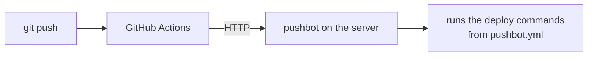

# pushbot

**English** | [Русский](README.ru.md)

A tiny CI/CD daemon for homelabs and personal servers. GitHub Actions builds an
image, pushes it to a registry and, as its last step, calls pushbot on the server.
pushbot puts the project files in place, writes `.env` from GitHub Secrets and runs
the steps from `pushbot.yml`. CI needs no SSH access and no auth secrets: requests
are verified with GitHub Actions OIDC tokens.



## With an AI agent

pushbot comes with an [agent skill](skills/pushbot/SKILL.md) for Claude Code, Codex,
Cursor, Gemini CLI and other agents. It tells the agent how to connect a repository,
install the daemon and debug a failed deploy, including the mistakes agents tend to
make there.

Nothing to install: paste one of these prompts into the agent.

```text
Connect this repository to my pushbot server. Download https://raw.githubusercontent.com/nikitakiselev/pushbot/v1/skills/pushbot/SKILL.md with curl, read it in full and follow it.
```

```text
Install pushbot on this server. Download https://raw.githubusercontent.com/nikitakiselev/pushbot/v1/skills/pushbot/SKILL.md with curl, read it in full and follow it.
```

```text
The pushbot deploy failed, find out why. Download https://raw.githubusercontent.com/nikitakiselev/pushbot/v1/skills/pushbot/SKILL.md with curl, read it in full and follow it.
```

Or install the skill once, and the agent uses it whenever pushbot comes up:

```sh
npx skills add nikitakiselev/pushbot    # Codex, Cursor, Gemini CLI, Claude Code and others
```

In Claude Code you can install it as a plugin instead:
`/plugin install pushbot --marketplace nikitakiselev/pushbot` (Claude Code 2.1.275 or
later; on older versions, `/plugin marketplace add nikitakiselev/pushbot`, then
`/plugin install pushbot@pushbot`).

## Server installation

Requires Linux with systemd and Docker.

```sh
curl -fsSL https://raw.githubusercontent.com/nikitakiselev/pushbot/main/install.sh \
  | sudo PUSHBOT_ALLOW='your-github-login/*' sh
```

**`PUSHBOT_ALLOW`** — which GitHub repositories may deploy to this server. The
format is `owner/repo-pattern`: `your-github-login/*` allows any of your
repositories (including future ones), `your-github-login/homelab-*` only those with
that prefix. Without this restriction a token from any repository on GitHub would
pass: GitHub signs tokens for everyone.

The value goes into `allow` of a new `/etc/pushbot/config.yml`. If the config
already exists, the variable is ignored. If you omit it, the script creates a config
with a placeholder and does not start the service until you fill in `allow`
yourself. The variable sets a single pattern; for more, add them to `allow` in the
config (see [Daemon config](#daemon-config)).

The script (worth reading, it is short) installs the binary to `/usr/local/bin`,
creates the `pushbot` user in the `docker` group, the `/srv/apps` and
`/var/lib/pushbot` directories, the `/etc/pushbot/config.yml` config and a systemd
service. Running it again upgrades pushbot and leaves the config alone.

### Reverse proxy

The daemon listens on `127.0.0.1:9800` over plain HTTP. A reverse proxy with TLS
exposes it: requests carry secrets from `env`, so plain HTTP must not face the
internet. The proxy has to do three things: accept request bodies up to ~50 MB (the
files archive), not buffer the response (otherwise the deploy log reaches Actions
only at the end), and keep the connection open while the deploy runs (up to 15
minutes).

**Caddy** (`Caddyfile`). Caddy gets the certificate itself; body size and response
time are unlimited by default:

```
pushbot.example.com {
    reverse_proxy 127.0.0.1:9800 {
        flush_interval -1    # stream the log immediately, no buffering
    }
}
```

**nginx** (`/etc/nginx/sites-available/pushbot`, certificate e.g. from certbot):

```nginx
server {
    listen 443 ssl;
    server_name pushbot.example.com;

    ssl_certificate     /etc/letsencrypt/live/pushbot.example.com/fullchain.pem;
    ssl_certificate_key /etc/letsencrypt/live/pushbot.example.com/privkey.pem;

    location / {
        proxy_pass http://127.0.0.1:9800;
        proxy_http_version 1.1;
        proxy_set_header Host $host;
        proxy_set_header X-Forwarded-For $proxy_add_x_forwarded_for;

        client_max_body_size 64m;   # default is 1m; the archive is up to 50 MB (max_bundle_size)
        proxy_buffering off;        # stream the log immediately, no buffering
        proxy_read_timeout 20m;     # longer than deploy_timeout (15m)
    }
}

server {
    listen 80;
    server_name pushbot.example.com;
    return 301 https://$host$request_uri;
}
```

If the proxy itself runs in a Docker container, `127.0.0.1` inside the container is
the container, not the server. Either run the proxy with `network_mode: host`, or set
`listen: 172.17.0.1:9800` in `/etc/pushbot/config.yml` (the host address on the
`docker0` network, check with `ip addr show docker0`) and proxy to that.

Check: `curl https://pushbot.example.com/healthz` should return `ok`. Or check everything
at once: `sudo pushbot doctor --url https://pushbot.example.com`.

## Managing the service

```sh
sudo pushbot doctor                     # self-check, with a fix for every problem
sudo systemctl status pushbot           # is it running? shows the last log lines
sudo systemctl restart pushbot          # after editing /etc/pushbot/config.yml
sudo systemctl stop pushbot             # waits for running deploys (up to 16 min)
sudo systemctl start pushbot
sudo journalctl -u pushbot -f           # follow the daemon log
sudo journalctl -u pushbot --since today   # deploy summaries, rejected requests
curl -s http://127.0.0.1:9800/healthz   # prints "ok" when the daemon is up
pushbot version
```

Deploy logs, one file per deploy, newest first:

```sh
sudo ls -t /var/lib/pushbot/logs/my-service/
sudo sh -c 'cat "$(ls -t /var/lib/pushbot/logs/my-service/*.log | head -n1)"'
```

## Upgrading

```sh
sudo pushbot upgrade                    # to the latest release
sudo pushbot upgrade --version v1.0.0   # a specific release, e.g. to roll back
```

It downloads the release from GitHub, checks its checksum, replaces the binary and
the systemd unit, and restarts the service (the restart waits for running deploys).
The config is not touched.

v1.0.0 and v1.1.0 have no `upgrade` command: to upgrade from them, run the install
command again (the config is kept).

## Adding a project

Nothing to do on the server. In the project repository:

**1. `pushbot.yml` in the root:**

```yaml
# pushbot.yml
files:
  - docker-compose.yml
env:
  secrets: [DB_PASSWORD]
```

**2. A step in the workflow:**

```yaml
on:
  push:
    branches: [main]

permissions:
  contents: read
  packages: write     # push the image to GHCR
  id-token: write     # OIDC token for pushbot

jobs:
  deploy:
    runs-on: ubuntu-latest
    environment: production
    steps:
      - uses: actions/checkout@v4
      - uses: docker/login-action@v3
        with: { registry: ghcr.io, username: "${{ github.actor }}", password: "${{ github.token }}" }
      - uses: docker/build-push-action@v6
        with: { push: true, tags: "ghcr.io/${{ github.repository }}:${{ github.sha }}" }

      - uses: nikitakiselev/pushbot@v1
        with:
          url: https://pushbot.example.com
          secrets: ${{ toJSON(secrets) }}
          env: |
            IMAGE_TAG=${{ github.sha }}
```

This becomes the `.env` file next to `docker-compose.yml` on the server; compose
reads it by itself. In the example:

- `IMAGE_TAG` is the tag of the image just built. In `docker-compose.yml` use
  `image: ghcr.io/<owner>/<repo>:${IMAGE_TAG}`, and the server runs exactly this commit.
  GHCR needs lower-case names: if the owner or repository name has capitals, write
  the image name out in lower case here and in `tags`.
- `DB_PASSWORD` is a secret: set it once with `gh secret set DB_PASSWORD --env production`
  (or under Settings → Environments → production) and use it in compose as
  `${DB_PASSWORD}`. The action sends the server only the secrets listed in
  `env.secrets`.

Non-secret settings are easier to keep as a file in the repository, see
[Environment variables](#environment-variables).

**3. Push.** The project appears in `/srv/apps/<repository name>`.

## `pushbot.yml`

```yaml
# pushbot.yml
name: my-service          # optional; defaults to the lower-cased repository name

files:                    # what to put into /srv/apps/<name>
  - docker-compose.yml
  - config/                                  # a whole directory
  - deploy/compose.prod.yml: compose.yml     # renamed
  - deploy/: .                               # directory contents into the project root

env:                      # optional; see "Environment variables"
  file: deploy/production.env                # non-secret settings, as is
  secrets: [APP_KEY, DB_PASSWORD]            # GitHub secret names

steps:                    # optional; defaults to:
  - run: docker compose pull
  - run: docker compose up -d --remove-orphans

environments:             # optional; see "Environments"
  production: {}
  staging:
    name: my-service-staging
    env:
      file: deploy/staging.env
```

Deploy order: files from `files` → `.env` → steps, one by one.

- **Files** are overwritten, but **nothing is deleted**: container data in the
  project directory (`./data` etc.) is safe. Paths are relative, without `..`;
  symlinks are not supported.
- **`.env`** is fully rewritten on every deploy (mode `0600`), see
  [Environment variables](#environment-variables). `.env` cannot be listed in `files`.
- **Steps** run as `sh -e -c '<run>'` in the project directory; the first error stops
  the deploy. The environment contains the variables from the `env` input and secrets
  plus `PUSHBOT_PROJECT`, `PUSHBOT_ENVIRONMENT`, `PUSHBOT_REPOSITORY`, `PUSHBOT_SHA`,
  `PUSHBOT_REF`, `PUSHBOT_ACTOR`, `PUSHBOT_RUN_ID`, `PUSHBOT_RUN_URL`. The daemon's
  environment is not inherited.

There is no automatic rollback: to roll back, re-run the workflow for the previous
commit.

## Environment variables

`.env` is built from three sources:

| Source | Where it is set | What goes there |
|---|---|---|
| A file in the repository | `env.file` in `pushbot.yml` | non-secret settings |
| GitHub secrets | names in `env.secrets` in `pushbot.yml`, values in GitHub Secrets | passwords, keys, tokens |
| The action's `env` input | `env:` of the workflow step | values computed in CI, such as `IMAGE_TAG` |

```yaml
# pushbot.yml
env:
  file: deploy/production.env
  secrets: [APP_KEY, DB_PASSWORD]
```

```sh
gh secret set APP_KEY --env production
gh secret set DB_PASSWORD --env production
```

On the server this becomes:

```
# pushbot: env input
IMAGE_TAG='a1b2c3d…'
# pushbot: secrets
APP_KEY='base64:…'
DB_PASSWORD='…'
# pushbot: deploy/production.env
APP_NAME="My Service"
DATABASE_URL="mysql://app:${DB_PASSWORD}@db/app"
```

- **The file** goes into `.env` as is: quotes, `${…}` and comments are handled by
  compose and the application, just like locally. It comes last, so it can refer to
  secrets and `env`. Keep secrets out of it: its values are not masked in logs.
- **Secrets and `env`** are taken literally and written in single quotes so compose
  does not expand `$`; nothing needs escaping. Values with `'` or line breaks are not
  supported. A value wrapped in double quotes, or `${KEY}` with a key from any source,
  is an error: that is copied dotenv syntax, move such a variable to the file. pushbot
  warns about `$$` in the log: it stays `$$`.
- **One key, one source**: a key set in two sources is an error before the deploy.
- Secrets are looked up case-insensitively, like GitHub does. The action gets all
  secrets of the job (`toJSON(secrets)`) but sends the server only those listed in
  `env.secrets`; if one is missing in GitHub, the action fails before the request.
- Steps get the variables from secrets and `env` in their environment. Variables from
  the file reach them only through `.env`: compose reads it by itself, a shell step
  can use `set -a; . ./.env; set +a`.

Keep one GitHub secret per variable rather than the whole `.env` in one secret: a
secret cannot be read back, so changing one line would need the whole file.

Your own scripts on the server (backups and the like) should read `.env` through the
shell rather than `grep | cut`, which returns the value with its quotes:

```sh
DB_PASSWORD="$(. /srv/apps/my-service/.env && printf '%s' "$DB_PASSWORD")"
```

This works as long as the file from the repository is valid `sh` too.

## Environments

One `pushbot.yml` can describe several GitHub environments (`environment:` of the
job), such as staging and production:

```yaml
name: my-service
files: [docker-compose.yml]
env:
  file: deploy/production.env
  secrets: [APP_KEY, DB_PASSWORD]

environments:
  production: {}
  staging:
    name: my-service-staging
    env:
      file: deploy/staging.env
```

- pushbot takes the environment from the job's OIDC token; no extra input is needed.
- An environment can override `name`, `files`, `env.file` and `env.secrets`; a key
  replaces the top-level value as a whole. Steps are shared by all environments, so
  staging tests the same deploy as production; if a step must behave differently,
  check `$PUSHBOT_ENVIRONMENT` in it.
- If `environments` is set, the job's environment must be listed (`production: {}` is
  an environment without overrides), otherwise the deploy is rejected.
- Secret values per environment live in GitHub Environments under the same names:
  `gh secret set DB_PASSWORD --env staging`.
- Environments on the same server need different `name`s.

## Action inputs

| Input | Default | |
|---|---|---|
| `url` | — | pushbot address, required |
| `env` | empty | `KEY=VALUE` lines for `.env`, values taken as is |
| `secrets` | empty | `${{ toJSON(secrets) }}` when `pushbot.yml` has `env.secrets` |
| `config` | `pushbot.yml` | manifest path relative to the repository root |
| `registry-auth` | `true` | send the temporary `github.token` so the server can pull a private image from ghcr.io |
| `audience` | `pushbot` | OIDC token audience |

## Daemon config

`/etc/pushbot/config.yml`; after changes run `systemctl restart pushbot`.

```yaml
listen: 127.0.0.1:9800
projects_root: /srv/apps
allow:
  - your-github-login/*       # owner is literal, the repository name is a pattern
  - my-org/homelab-*
# optional (defaults):
# state_dir: /var/lib/pushbot
# audience: pushbot
# deploy_timeout: 15m
# max_bundle_size: 50MB
# max_unpacked_size: 200MB
# log_retention: 20
# metrics_listen: 127.0.0.1:9801   # Prometheus /metrics, disabled by default
```

On startup pushbot looks up the numeric GitHub IDs of the owners in `allow` and
matches tokens by ID rather than by name (an account name can be released and taken
by someone else). The IDs are cached in `owners.json` in case GitHub is unreachable.
If the `GITHUB_TOKEN` environment variable is set, API requests use it (higher rate
limit).

## Security

- Push access to an allowed repository = the right to run commands on the server as
  the `pushbot` user, and the `docker` group is effectively root. This is a
  deliberate trade-off for personal use; the protection is OIDC and `allow`.
- A token is checked for GitHub's signature, `iss`, `aud`, lifetime and single use
  (`jti`). Pull requests from forks do not get OIDC tokens.
- The first deploy binds the project name to the repository (by `repository_id`);
  another repository with the same `name` gets 403. To release a name, remove its
  entry from `/var/lib/pushbot/projects.json`.
- `env` and secret values of 4 characters or more are masked as `***` in the server
  logs (shorter ones such as `1` or `on` would garble them); values from the env file
  are not masked. GitHub masks secrets in the Actions log.

## Logs

- Each deploy: `/var/lib/pushbot/logs/<name>/<time>-<sha>.log` (the last 20 are kept).
- Summary and rejected requests: `journalctl -u pushbot`.

If the Actions job is cancelled, the deploy still runs to completion — check the log
on the server.

## Metrics

Set `metrics_listen` to expose Prometheus metrics at `/metrics`. They are served on
a separate address, not on the deploy port, so they don't leak through the reverse
proxy. If Prometheus runs on another machine, use the server's LAN address.

```yaml
# /etc/pushbot/config.yml
metrics_listen: 127.0.0.1:9801
```

```yaml
# prometheus.yml
scrape_configs:
  - job_name: pushbot
    static_configs:
      - targets: ["127.0.0.1:9801"]
```

| Metric | Type | |
|---|---|---|
| `pushbot_deploys_total{project, result}` | counter | finished deploys; `result` is `success`, `failed` or `timeout` |
| `pushbot_deploy_duration_seconds{project}` | histogram | deploy duration |
| `pushbot_deploy_in_progress{project}` | gauge | deploys running right now |
| `pushbot_last_deploy_success{project}` | gauge | 1 if the last deploy succeeded, 0 if it failed |
| `pushbot_last_deploy_timestamp_seconds{project}` | gauge | when the last deploy finished |
| `pushbot_requests_rejected_total{code}` | counter | requests rejected with 400/401/403/413/503; a spike of 401/403 means someone is trying foreign tokens |
| `pushbot_build_info{version}` | gauge | pushbot version |

Plus the standard `go_*` and `process_*` metrics. Example alert:

```yaml
groups:
  - name: pushbot
    rules:
      - alert: PushbotDeployFailed
        expr: pushbot_last_deploy_success == 0
        annotations:
          summary: "Last deploy of {{ $labels.project }} failed"
```

## Development

```sh
go test -race ./...
```

The tests in `internal/e2e` run the real `action.sh` (requires `bash`, `yq`, `jq`,
`curl`, `tar`). CI also deploys through the action with real GitHub OIDC tokens. To
release, push a `vX.Y.Z` tag: GoReleaser publishes the binaries and the `v1` tag is
moved to the new release.

The agent skill in `skills/pushbot/` repeats much of this README for agents: change
both when behaviour changes. The tests in `internal/docs` parse every `pushbot.yml`
example (a `yaml` block starting with `# pushbot.yml`) in the READMEs and the skill,
and check the skill's links.

Design (in Russian): [`docs/superpowers/specs/2026-10-14-pushbot-design.md`](docs/superpowers/specs/2026-10-14-pushbot-design.md).
