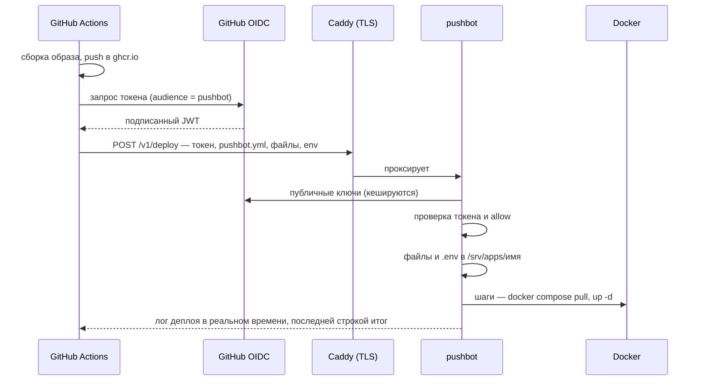

# pushbot

Маленький демон для CI/CD в homelab и на личных серверах. GitHub Actions собирает
образ, пушит его в registry и последним шагом вызывает pushbot на сервере. pushbot
раскладывает файлы проекта, пишет `.env` из GitHub Secrets и выполняет шаги из
`pushbot.yml`. SSH-доступ из CI не нужен, секретов для авторизации тоже: запросы
проверяются по OIDC-токенам GitHub Actions.



## Установка на сервер

Нужны Linux с systemd и Docker.

```sh
curl -fsSL https://raw.githubusercontent.com/nikitakiselev/pushbot/main/install.sh \
  | sudo PUSHBOT_ALLOW='your-github-login/*' sh
```

Скрипт (его стоит прочитать, он короткий) ставит бинарник в `/usr/local/bin`,
создаёт пользователя `pushbot` в группе `docker`, директории `/srv/apps` и
`/var/lib/pushbot`, конфиг `/etc/pushbot/config.yml` и systemd-сервис. Повторный
запуск обновляет pushbot и не трогает конфиг.

Демон слушает `127.0.0.1:9800`. Наружу его отдаёт Caddy:

```
deploy.example.com {
    reverse_proxy 127.0.0.1:9800 {
        flush_interval -1
    }
}
```

## Подключение проекта

На сервере ничего делать не нужно. В репозитории проекта:

**1. `pushbot.yml` в корне:**

```yaml
files:
  - docker-compose.yml
```

**2. Шаг в workflow:**

```yaml
on:
  push:
    branches: [main]

permissions:
  contents: read
  packages: write     # пуш образа в GHCR
  id-token: write     # OIDC-токен для pushbot

jobs:
  deploy:
    runs-on: ubuntu-latest
    environment: production
    steps:
      - uses: actions/checkout@v4
      - uses: docker/login-action@v3
        with: { registry: ghcr.io, username: "${{ github.actor }}", password: "${{ github.token }}" }
      - uses: docker/build-push-action@v6
        with: { push: true, tags: "ghcr.io/${{ github.repository }}:${{ github.sha }}" }

      - uses: nikitakiselev/pushbot@v1
        with:
          url: https://deploy.example.com
          env: |
            IMAGE_TAG=${{ github.sha }}
            DB_PASSWORD=${{ secrets.DB_PASSWORD }}
```

В `docker-compose.yml` укажите `image: ghcr.io/<owner>/<repo>:${IMAGE_TAG}`.

**3. Push.** Проект появится в `/srv/apps/<имя репозитория>`.

## `pushbot.yml`

```yaml
name: my-service          # необязательно; по умолчанию — имя репозитория в нижнем регистре

files:                    # что положить в /srv/apps/<name>
  - docker-compose.yml
  - config/                                  # директория целиком
  - deploy/compose.prod.yml: compose.yml     # с переименованием
  - deploy/: .                               # содержимое директории в корень проекта

steps:                    # необязательно; по умолчанию:
  - run: docker compose pull
  - run: docker compose up -d --remove-orphans
```

Порядок деплоя: файлы из `files` → `.env` → шаги по очереди.

- **Файлы** перезаписываются, но **ничего не удаляется**: данные контейнеров в
  директории проекта (`./data` и т. п.) в безопасности. Пути относительные, без `..`;
  symlink'и не поддерживаются.
- **`.env`** целиком перезаписывается значениями из входа `env` (права `0600`,
  значения в одинарных кавычках, чтобы compose не подставлял `$`). Указывать `.env`
  в `files` нельзя.
- **Шаги** выполняются как `sh -e -c '<run>'` в директории проекта, первая ошибка
  останавливает деплой. В окружении — переменные из `env` и `PUSHBOT_PROJECT`,
  `PUSHBOT_REPOSITORY`, `PUSHBOT_SHA`, `PUSHBOT_REF`, `PUSHBOT_ACTOR`,
  `PUSHBOT_RUN_ID`, `PUSHBOT_RUN_URL`. Окружение демона не наследуется.

Автоматического отката нет: чтобы откатиться, перезапустите workflow для
предыдущего коммита.

## Входы action

| Вход | По умолчанию | |
|---|---|---|
| `url` | — | адрес pushbot, обязателен |
| `env` | пусто | строки `KEY=VALUE` для `.env` |
| `config` | `pushbot.yml` | путь к манифесту от корня репозитория |
| `registry-auth` | `true` | передать временный `github.token`, чтобы сервер мог стянуть приватный образ из ghcr.io |
| `audience` | `pushbot` | audience OIDC-токена |

## Конфиг демона

`/etc/pushbot/config.yml`, после изменений — `systemctl restart pushbot`.

```yaml
listen: 127.0.0.1:9800
projects_root: /srv/apps
allow:
  - your-github-login/*       # владелец — без масок, имя репозитория — маска
  - my-org/homelab-*
# необязательно (значения по умолчанию):
# state_dir: /var/lib/pushbot
# audience: pushbot
# deploy_timeout: 15m
# max_bundle_size: 50MB
# max_unpacked_size: 200MB
# log_retention: 20
```

При старте pushbot узнаёт у GitHub числовые ID владельцев из `allow` и сверяет
токены по ним, а не по имени (имя аккаунта можно освободить и занять заново). ID
кешируются в `owners.json` на случай, если GitHub недоступен. Если задана переменная
окружения `GITHUB_TOKEN`, запросы к API идут с ней (выше лимит запросов).

## Безопасность

- Право пушить в разрешённый репозиторий = право выполнять команды на сервере от
  пользователя `pushbot`, а группа `docker` фактически равна root. Это осознанный
  компромисс для личного использования; защита — OIDC и `allow`.
- Токен проверяется по подписи GitHub, `iss`, `aud`, сроку жизни и одноразовости
  (`jti`). PR из форков OIDC-токенов не получают.
- Первый деплой закрепляет имя проекта за репозиторием (по `repository_id`); другой
  репозиторий с тем же `name` получит 403. Освободить имя — удалить запись из
  `/var/lib/pushbot/projects.json`.
- Значения из `env` маскируются как `***` в логах на сервере; в логе Actions секреты
  маскирует GitHub.

## Логи

- Каждый деплой: `/var/lib/pushbot/logs/<name>/<время>-<sha>.log` (последние 20).
- Сводка и отклонённые запросы: `journalctl -u pushbot`.

Если job в Actions отменили, деплой всё равно доводится до конца — смотрите лог на
сервере.

## Разработка

```sh
go test -race ./...
```

Тесты в `internal/e2e` запускают настоящий `action.sh` (нужны `bash`, `yq`, `jq`,
`curl`, `tar`). CI дополнительно деплоит через action с настоящими OIDC-токенами
GitHub. Релиз — тег `vX.Y.Z`: GoReleaser публикует бинарники, а тег `v1` переносится
на свежий релиз.

Дизайн: [`docs/superpowers/specs/2026-10-14-pushbot-design.md`](docs/superpowers/specs/2026-10-14-pushbot-design.md).
