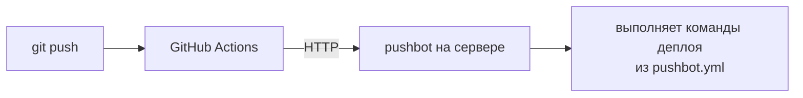

# pushbot

[English](README.md) | **Русский**

Маленький демон для CI/CD в homelab и на личных серверах. GitHub Actions собирает
образ, пушит его в registry и последним шагом вызывает pushbot на сервере. pushbot
раскладывает файлы проекта, пишет `.env` из GitHub Secrets и выполняет шаги из
`pushbot.yml`. SSH-доступ из CI не нужен, секретов для авторизации тоже: запросы
проверяются по OIDC-токенам GitHub Actions.



## С AI-агентом

У pushbot есть [скилл для агентов](skills/pushbot/SKILL.md): Claude Code, Codex,
Cursor, Gemini CLI и других. Он объясняет агенту, как подключить репозиторий,
установить демон и разобрать упавший деплой, и предупреждает об ошибках, которые
агенты обычно делают.

Ничего устанавливать не нужно: вставьте агенту один из промптов.

```text
Подключи этот репозиторий к моему серверу pushbot. Скачай https://raw.githubusercontent.com/nikitakiselev/pushbot/v1/skills/pushbot/SKILL.md через curl, прочитай целиком и следуй инструкции.
```

```text
Установи pushbot на этот сервер. Скачай https://raw.githubusercontent.com/nikitakiselev/pushbot/v1/skills/pushbot/SKILL.md через curl, прочитай целиком и следуй инструкции.
```

```text
Деплой через pushbot упал, выясни почему. Скачай https://raw.githubusercontent.com/nikitakiselev/pushbot/v1/skills/pushbot/SKILL.md через curl, прочитай целиком и следуй инструкции.
```

Или установите скилл один раз, и агент будет использовать его каждый раз, когда речь
зайдёт о pushbot:

```sh
npx skills add nikitakiselev/pushbot    # Codex, Cursor, Gemini CLI, Claude Code и другие
```

В Claude Code его можно поставить и как плагин:
`/plugin install pushbot --marketplace nikitakiselev/pushbot` (Claude Code 2.1.275 и
новее; в более старых — `/plugin marketplace add nikitakiselev/pushbot`, затем
`/plugin install pushbot@pushbot`).

## Установка на сервер

Нужны Linux с systemd и Docker.

```sh
curl -fsSL https://raw.githubusercontent.com/nikitakiselev/pushbot/main/install.sh | sudo sh
sudo pushbot init
```

Скрипт (его стоит прочитать, он короткий) ставит бинарник в `/usr/local/bin`,
создаёт пользователя `pushbot` в группе `docker`, директорию `/var/lib/pushbot` и
systemd-сервис. Повторный запуск обновляет pushbot и не трогает конфиг.

`pushbot init` спрашивает настройки, показывает получившийся
`/etc/pushbot/config.yml` и после подтверждения записывает его, запускает сервис и
проверяет, что тот отвечает:

- **Кто может деплоить** (`allow`): репозитории GitHub в формате
  `владелец/маска-репозитория`. `your-github-login/*` — любой ваш репозиторий
  (включая будущие), `your-github-login/homelab-*` — только с таким префиксом;
  несколько шаблонов перечисляются через запятую. Без этого ограничения прошёл бы
  токен любого репозитория на GitHub: GitHub подписывает токены для всех. Каждый
  владелец сразу ищется на GitHub, так что опечатка видна здесь, а не тогда, когда
  сервис не сможет запуститься.
- **Адрес демона**, по умолчанию `127.0.0.1:9800`: сюда подключается reverse proxy.
- **Директория проектов**, по умолчанию `/srv/apps`: по одной поддиректории на проект.
- **Адрес метрик Prometheus**, по умолчанию пусто (выключены), см. [Метрики](#метрики).

Для скриптов и автоматической настройки передайте настройки флагами, тогда мастера
не будет:

```sh
sudo pushbot init --allow 'your-github-login/*' --allow 'my-org/homelab-*'
```

Флаги: `--allow` (повторите для нескольких шаблонов), `--listen`,
`--projects-root` и `--metrics-listen`. При повторном запуске `pushbot init`
отталкивается от существующего конфига: мастер показывает его значения, а флаги
меняют только названные настройки, но требуют `--force` (`--allow` заменяет весь
список). Предыдущий файл сохраняется как `config.yml.bak`.

### Reverse proxy

Демон слушает `127.0.0.1:9800` по обычному HTTP. Наружу его отдаёт reverse proxy с
TLS: в запросе передаются секреты из `env`, так что голый HTTP наружу недопустим.
От прокси нужно три вещи: пропускать тело запроса до ~50 МБ (архив с файлами),
не буферизовать ответ (иначе лог деплоя придёт в Actions только в конце) и не
обрывать соединение, пока идёт деплой (до 15 минут).

**Caddy** (`Caddyfile`). Сертификат Caddy получит сам, размер тела и время ответа
по умолчанию не ограничены:

```
pushbot.example.com {
    reverse_proxy 127.0.0.1:9800 {
        flush_interval -1    # отдавать лог сразу, без буфера
    }
}
```

**nginx** (`/etc/nginx/sites-available/pushbot`, сертификат — например, от certbot):

```nginx
server {
    listen 443 ssl;
    server_name pushbot.example.com;

    ssl_certificate     /etc/letsencrypt/live/pushbot.example.com/fullchain.pem;
    ssl_certificate_key /etc/letsencrypt/live/pushbot.example.com/privkey.pem;

    location / {
        proxy_pass http://127.0.0.1:9800;
        proxy_http_version 1.1;
        proxy_set_header Host $host;
        proxy_set_header X-Forwarded-For $proxy_add_x_forwarded_for;

        client_max_body_size 64m;   # по умолчанию 1m; архив до 50 МБ (max_bundle_size)
        proxy_buffering off;        # отдавать лог сразу, без буфера
        proxy_read_timeout 20m;     # больше deploy_timeout (15m)
    }
}

server {
    listen 80;
    server_name pushbot.example.com;
    return 301 https://$host$request_uri;
}
```

Если прокси сам работает в Docker-контейнере, `127.0.0.1` внутри контейнера — это
сам контейнер, а не сервер. Тогда либо запустите прокси с `network_mode: host`, либо
переключите pushbot на адрес хоста в сети `docker0` (проверьте его
`ip addr show docker0`) командой `sudo pushbot init --force --listen 172.17.0.1:9800`
и проксируйте на него.

Проверка: `curl https://pushbot.example.com/healthz` должен вернуть `ok`. Или проверить
всё сразу: `sudo pushbot doctor --url https://pushbot.example.com`.

## Управление сервисом

```sh
sudo pushbot doctor                     # самопроверка, к каждой проблеме — как исправить
sudo systemctl status pushbot           # запущен ли; последние строки лога
sudo pushbot init                       # поменять настройки, перезапускает сервис
sudo systemctl restart pushbot          # после правки /etc/pushbot/config.yml
sudo systemctl stop pushbot             # ждёт завершения текущих деплоев (до 16 минут)
sudo systemctl start pushbot
sudo journalctl -u pushbot -f           # лог демона в реальном времени
sudo journalctl -u pushbot --since today   # сводки деплоев, отклонённые запросы
curl -s http://127.0.0.1:9800/healthz   # выводит "ok", если демон работает
pushbot version
```

Логи деплоев, по файлу на деплой, свежие сверху:

```sh
sudo ls -t /var/lib/pushbot/logs/my-service/
sudo sh -c 'cat "$(ls -t /var/lib/pushbot/logs/my-service/*.log | head -n1)"'
```

## Обновление

```sh
sudo pushbot upgrade                    # до последнего релиза
sudo pushbot upgrade --version v1.0.0   # конкретный релиз, например для отката
```

Команда скачивает релиз с GitHub, проверяет контрольную сумму, заменяет бинарник и
systemd-юнит и перезапускает сервис (перезапуск дожидается текущих деплоев). Конфиг
не трогается.

В v1.0.0 и v1.1.0 команды `upgrade` нет: чтобы обновиться с них, запустите команду
установки ещё раз (конфиг сохранится).

## Подключение проекта

На сервере ничего делать не нужно. В репозитории проекта:

**1. `pushbot.yml` в корне:**

```yaml
# pushbot.yml
files:
  - docker-compose.yml
env:
  secrets: [DB_PASSWORD]
```

**2. Шаг в workflow:**

```yaml
on:
  push:
    branches: [main]

permissions:
  contents: read
  packages: write     # пуш образа в GHCR
  id-token: write     # OIDC-токен для pushbot

jobs:
  deploy:
    runs-on: ubuntu-latest
    environment: production
    steps:
      - uses: actions/checkout@v4
      - uses: docker/login-action@v3
        with: { registry: ghcr.io, username: "${{ github.actor }}", password: "${{ github.token }}" }
      - uses: docker/build-push-action@v6
        with: { push: true, tags: "ghcr.io/${{ github.repository }}:${{ github.sha }}" }

      - uses: nikitakiselev/pushbot@v1
        with:
          url: https://pushbot.example.com
          secrets: ${{ toJSON(secrets) }}
          env: |
            IMAGE_TAG=${{ github.sha }}
```

Из этого получается файл `.env` рядом с `docker-compose.yml` на сервере; compose
читает его сам. В примере:

- `IMAGE_TAG` — тег только что собранного образа. В `docker-compose.yml` укажите
  `image: ghcr.io/<owner>/<repo>:${IMAGE_TAG}`, и сервер запустит образ именно этого
  коммита. GHCR принимает имена только в нижнем регистре: если в имени владельца или
  репозитория есть заглавные буквы, впишите имя образа в нижнем регистре и здесь, и
  в `tags`.
- `DB_PASSWORD` — секрет: задайте его один раз командой
  `gh secret set DB_PASSWORD --env production` (или в Settings → Environments →
  production) и используйте в compose как `${DB_PASSWORD}`. Action отправляет на
  сервер только секреты, перечисленные в `env.secrets`.

Несекретные настройки удобнее держать файлом в репозитории — см.
[Переменные окружения](#переменные-окружения).

**3. Push.** Проект появится в `/srv/apps/<имя репозитория>`.

## `pushbot.yml`

```yaml
# pushbot.yml
name: my-service          # необязательно; по умолчанию — имя репозитория в нижнем регистре

files:                    # что положить в /srv/apps/<name>
  - docker-compose.yml
  - config/                                  # директория целиком
  - deploy/compose.prod.yml: compose.yml     # с переименованием
  - deploy/: .                               # содержимое директории в корень проекта

env:                      # необязательно; см. «Переменные окружения»
  file: deploy/production.env                # несекретные настройки, как есть
  secrets: [APP_KEY, DB_PASSWORD]            # имена секретов GitHub

steps:                    # необязательно; по умолчанию:
  - run: docker compose pull
  - run: docker compose up -d --remove-orphans

environments:             # необязательно; см. «Окружения»
  production: {}
  staging:
    name: my-service-staging
    env:
      file: deploy/staging.env
```

Порядок деплоя: файлы из `files` → `.env` → шаги по очереди.

- **Файлы** перезаписываются, но **ничего не удаляется**: данные контейнеров в
  директории проекта (`./data` и т. п.) в безопасности. Пути относительные, без `..`;
  symlink'и не поддерживаются.
- **`.env`** целиком перезаписывается при каждом деплое (права `0600`), см.
  [Переменные окружения](#переменные-окружения). Указывать `.env` в `files` нельзя.
- **Шаги** выполняются как `sh -e -c '<run>'` в директории проекта, первая ошибка
  останавливает деплой. В окружении — переменные из входа `env` и секретов, а также
  `PUSHBOT_PROJECT`, `PUSHBOT_ENVIRONMENT`, `PUSHBOT_REPOSITORY`, `PUSHBOT_SHA`,
  `PUSHBOT_REF`, `PUSHBOT_ACTOR`, `PUSHBOT_RUN_ID`, `PUSHBOT_RUN_URL`. Окружение
  демона не наследуется.

Автоматического отката нет: чтобы откатиться, перезапустите workflow для
предыдущего коммита.

## Переменные окружения

`.env` собирается из трёх источников:

| Источник | Где задаётся | Что туда класть |
|---|---|---|
| Файл из репозитория | `env.file` в `pushbot.yml` | несекретные настройки |
| Секреты GitHub | имена — `env.secrets` в `pushbot.yml`, значения — GitHub Secrets | пароли, ключи, токены |
| Вход `env` action | `env:` у шага в workflow | то, что вычисляется в CI, например `IMAGE_TAG` |

```yaml
# pushbot.yml
env:
  file: deploy/production.env
  secrets: [APP_KEY, DB_PASSWORD]
```

```sh
gh secret set APP_KEY --env production
gh secret set DB_PASSWORD --env production
```

На сервере получится:

```
# pushbot: env input
IMAGE_TAG='a1b2c3d…'
# pushbot: secrets
APP_KEY='base64:…'
DB_PASSWORD='…'
# pushbot: deploy/production.env
APP_NAME="My Service"
DATABASE_URL="mysql://app:${DB_PASSWORD}@db/app"
```

- **Файл** попадает в `.env` как есть: кавычки, `${…}` и комментарии обрабатывают
  compose и приложение, так же как локально. Он стоит последним, поэтому может
  ссылаться на секреты и `env`. Секреты в него не кладите: его значения не
  маскируются в логах.
- **Секреты и `env`** берутся буквально и пишутся в одинарных кавычках, чтобы compose
  не подставлял `$`; экранировать ничего не нужно. Значения с `'` и переводами строк
  не поддерживаются. Значение целиком в двойных кавычках или `${KEY}` с ключом из
  любого источника — ошибка: это скопированный dotenv-синтаксис, такую переменную
  перенесите в файл. На `$$` pushbot предупреждает в логе: он останется `$$`.
- **Один ключ — один источник**: ключ, заданный в двух источниках, — ошибка до деплоя.
- Секреты ищутся без учёта регистра, как в GitHub. Action получает все секреты job'а
  (`toJSON(secrets)`), но отправляет на сервер только перечисленные в `env.secrets`;
  если какого-то нет в GitHub, action падает ещё до запроса.
- Шаги получают в окружении переменные из секретов и `env`. Переменные из файла —
  только через `.env`: compose читает его сам, в shell-шаге — `set -a; . ./.env; set +a`.

Держите по секрету GitHub на переменную, а не весь `.env` одним секретом: секрет
нельзя прочитать, и чтобы поменять одну строку, понадобился бы весь файл.

Свои скрипты на сервере (бэкапы и т. п.) пусть читают `.env` через shell, а не
`grep | cut` — тот вернёт значение вместе с кавычками:

```sh
DB_PASSWORD="$(. /srv/apps/my-service/.env && printf '%s' "$DB_PASSWORD")"
```

Это работает, если файл из репозитория тоже совместим с `sh`.

## Окружения

Один `pushbot.yml` может описывать несколько окружений GitHub (`environment:` у
job), например staging и production:

```yaml
name: my-service
files: [docker-compose.yml]
env:
  file: deploy/production.env
  secrets: [APP_KEY, DB_PASSWORD]

environments:
  production: {}
  staging:
    name: my-service-staging
    env:
      file: deploy/staging.env
```

- Окружение pushbot берёт из OIDC-токена job'а, отдельный вход для этого не нужен.
- В окружении можно переопределить `name`, `files`, `env.file` и `env.secrets`; ключ
  целиком заменяет значение верхнего уровня. Шаги общие для всех окружений, чтобы
  staging проверял ту же процедуру деплоя, что и прод; если шаг должен вести себя
  иначе — проверьте в нём `$PUSHBOT_ENVIRONMENT`.
- Если `environments` задан, окружение job'а должно быть в списке
  (`production: {}` — окружение без переопределений), иначе деплой отклоняется.
- Значения секретов для разных окружений задаются в GitHub Environments под
  одинаковыми именами: `gh secret set DB_PASSWORD --env staging`.
- Окружениям на одном сервере нужны разные `name`.

## Входы action

| Вход | По умолчанию | |
|---|---|---|
| `url` | — | адрес pushbot, обязателен |
| `env` | пусто | строки `KEY=VALUE` для `.env`, значения как есть |
| `secrets` | пусто | `${{ toJSON(secrets) }}`, если в `pushbot.yml` есть `env.secrets` |
| `config` | `pushbot.yml` | путь к манифесту от корня репозитория |
| `registry-auth` | `true` | передать временный `github.token`, чтобы сервер мог стянуть приватный образ из ghcr.io |
| `audience` | `pushbot` | audience OIDC-токена |

## Конфиг демона

`/etc/pushbot/config.yml`, его пишет `pushbot init`. Поменять настройки можно через
`sudo pushbot init` или правкой файла с последующим `sudo systemctl restart pushbot`.

```yaml
listen: 127.0.0.1:9800
projects_root: /srv/apps
allow:
  - your-github-login/*       # владелец — без масок, имя репозитория — маска
  - my-org/homelab-*
# необязательно (значения по умолчанию):
# state_dir: /var/lib/pushbot
# audience: pushbot
# deploy_timeout: 15m
# max_bundle_size: 50MB
# max_unpacked_size: 200MB
# log_retention: 20
# metrics_listen: 127.0.0.1:9801   # Prometheus /metrics, по умолчанию выключено
```

При старте pushbot узнаёт у GitHub числовые ID владельцев из `allow` и сверяет
токены по ним, а не по имени (имя аккаунта можно освободить и занять заново). ID
кешируются в `owners.json` на случай, если GitHub недоступен. Если задана переменная
окружения `GITHUB_TOKEN`, запросы к API идут с ней (выше лимит запросов).

## Безопасность

- Право пушить в разрешённый репозиторий = право выполнять команды на сервере от
  пользователя `pushbot`, а группа `docker` фактически равна root. Это осознанный
  компромисс для личного использования; защита — OIDC и `allow`.
- Токен проверяется по подписи GitHub, `iss`, `aud`, сроку жизни и одноразовости
  (`jti`). PR из форков OIDC-токенов не получают.
- Первый деплой закрепляет имя проекта за репозиторием (по `repository_id`); другой
  репозиторий с тем же `name` получит 403. Освободить имя — удалить запись из
  `/var/lib/pushbot/projects.json`.
- Значения из `env` и секретов длиной от 4 символов маскируются как `***` в логах на
  сервере (короткие вроде `1` или `on` испортили бы лог); значения из env-файла не
  маскируются. В логе Actions секреты маскирует GitHub.

## Логи

- Каждый деплой: `/var/lib/pushbot/logs/<name>/<время>-<sha>.log` (последние 20).
- Сводка и отклонённые запросы: `journalctl -u pushbot`.

Если job в Actions отменили, деплой всё равно доводится до конца — смотрите лог на
сервере.

## Метрики

Задайте `metrics_listen`, и pushbot будет отдавать метрики Prometheus по `/metrics`.
Они висят на отдельном адресе, а не на порту деплоя, поэтому не утекают наружу через
reverse proxy. Если Prometheus стоит на другой машине, укажите LAN-адрес сервера.

```yaml
# /etc/pushbot/config.yml
metrics_listen: 127.0.0.1:9801
```

```yaml
# prometheus.yml
scrape_configs:
  - job_name: pushbot
    static_configs:
      - targets: ["127.0.0.1:9801"]
```

| Метрика | Тип | |
|---|---|---|
| `pushbot_deploys_total{project, result}` | counter | завершённые деплои; `result` — `success`, `failed` или `timeout` |
| `pushbot_deploy_duration_seconds{project}` | histogram | длительность деплоя |
| `pushbot_deploy_in_progress{project}` | gauge | деплои, идущие прямо сейчас |
| `pushbot_last_deploy_success{project}` | gauge | 1, если последний деплой успешен, 0 — если упал |
| `pushbot_last_deploy_timestamp_seconds{project}` | gauge | когда закончился последний деплой |
| `pushbot_requests_rejected_total{code}` | counter | отказы 400/401/403/413/503; всплеск 401/403 — кто-то пробует чужие токены |
| `pushbot_build_info{version}` | gauge | версия pushbot |

Плюс стандартные метрики `go_*` и `process_*`. Пример алерта:

```yaml
groups:
  - name: pushbot
    rules:
      - alert: PushbotDeployFailed
        expr: pushbot_last_deploy_success == 0
        annotations:
          summary: "Последний деплой {{ $labels.project }} упал"
```

## Разработка

```sh
go test -race ./...
```

Тесты в `internal/e2e` запускают настоящий `action.sh` (нужны `bash`, `yq`, `jq`,
`curl`, `tar`). CI дополнительно деплоит через action с настоящими OIDC-токенами
GitHub. Релиз — тег `vX.Y.Z`: GoReleaser публикует бинарники, а тег `v1` переносится
на свежий релиз.

Скилл для агентов в `skills/pushbot/` во многом повторяет этот README: при изменении
поведения правьте оба. Тесты в `internal/docs` разбирают каждый пример `pushbot.yml`
(блок `yaml`, который начинается с `# pushbot.yml`) в README и в скилле и проверяют
ссылки скилла.

Дизайн: [`docs/superpowers/specs/2026-10-14-pushbot-design.md`](docs/superpowers/specs/2026-10-14-pushbot-design.md).
